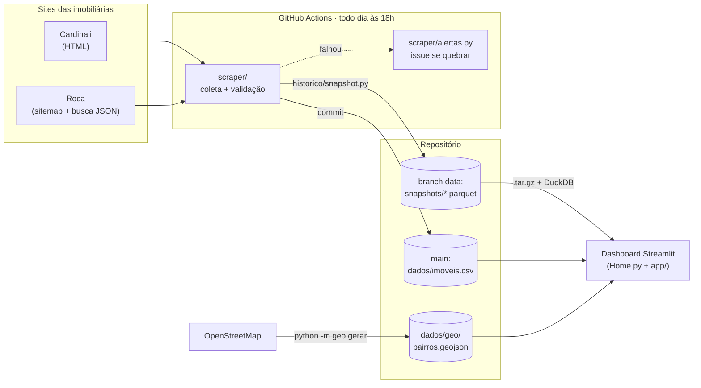

<h1 align="center">🗺️ Imobiliário Universitário</h1>

<p align="center">
  <b>Web scraper + dashboard interativo para quem procura aluguel perto da USP e da UFSCar, em São Carlos - SP</b>
</p>

<p align="center">
  <a href="https://imobiliariouniversitario.streamlit.app/" target="_blank">
    
  </a>
</p>

<p align="center">
  <a href="https://github.com/imarcososhiro/imobiliario_universitario/actions/workflows/main.yml"></a>
  <a href="https://github.com/imarcososhiro/imobiliario_universitario/actions/workflows/testes.yml"></a>
  
  
  
</p>

<p align="center">
  <a href="https://imobiliariouniversitario.streamlit.app/" target="_blank">
    
  </a>
</p>

> [!TIP]
> O site fica no Streamlit Community Cloud, que "dorme" quando ninguém acessa por um tempo. Se aparecer um aviso como o abaixo, clique no botão azul e espere uns segundos enquanto ele acorda.
>
> 

---

## Sumário

- [Sobre o projeto](#sobre-o-projeto)
- [Em números](#em-números)
- [Funcionalidades](#funcionalidades)
- [Como funciona](#como-funciona)
- [Rodando localmente](#rodando-localmente)
- [Estrutura do projeto](#estrutura-do-projeto)
- [Dicionário de dados](#dicionário-de-dados)
- [Métricas](#métricas)
- [Várias imobiliárias](#várias-imobiliárias)
- [Histórico no dashboard](#histórico-no-dashboard)
- [Do mapa à lista e da lista ao mapa](#do-mapa-à-lista-e-da-lista-ao-mapa)
- [Mapa dos bairros](#mapa-dos-bairros)
- [Operação](#operação)
- [Testes](#testes)
- [Tecnologias utilizadas](#tecnologias-utilizadas)
- [Aviso legal](#aviso-legal)
- [Desenvolvedor](#desenvolvedor)

---

## Sobre o projeto

Procurar onde morar em São Carlos costuma significar abrir dezenas de anúncios em sites diferentes, sem saber se o preço é bom nem quão longe o imóvel fica do campus. Este projeto resolve isso em três partes:

1. **Coleta** — um web scraper roda **todo dia** no GitHub Actions e junta os anúncios de aluguel de casas e apartamentos de São Carlos das imobiliárias **Cardinali** e **Roca**.
2. **Histórico** — cada coleta vira um arquivo Parquet num branch separado (`data`), formando uma série diária desde nov/2025 que pode ser consultada em SQL com DuckDB.
3. **Dashboard** — um app Streamlit mostra um **mapa dos bairros pintados pelo preço por quarto**, os bairros mais em conta, e cartões com cada imóvel, com filtros pensados para estudantes (onde você estuda, quantos quartos, quanto pode pagar por quarto, quão perto quer morar).

A pergunta que o painel responde é simples: **"quanto cada pessoa vai pagar, e quão longe da faculdade?"**. Por isso a métrica principal é o **preço por quarto** (o total do mês dividido pelo número de quartos), que permite comparar de forma justa uma kitnet com uma casa de república.

## Em números

Retrato da coleta de **18/10/2026** (os números mudam a cada dia):

| | |
|---|---|
| Imóveis coletados | **2.228** (1.026 da Cardinali e 1.202 da Roca) |
| Tipos | 1.535 apartamentos e 693 casas |
| Bairros com anúncios | 176 |
| Total mensal mediano (aluguel + condomínio + IPTU) | R$ 2.258 |
| Pedidos HTTP por coleta | ~1.000 na Cardinali e ~8 na Roca |
| Testes automatizados | 143, todos offline |

## Funcionalidades

✔️ **Coleta diária automática** — Todos os aluguéis de casas e apartamentos de São Carlos nas imobiliárias Cardinali e Roca, com validação antes de gravar (se a coleta parecer quebrada, o CSV anterior é mantido e uma issue é aberta).

✔️ **Preço por quarto** — Para cada imóvel: o total por mês ÷ nº de quartos (com um quarto para cada pessoa, é quanto cada uma paga), e o cartão mostra a conta, para quem vai dividir de outro jeito refazer. Também a **distância** até a USP, a UFSCar ou a rodoviária e o **tempo a pé** (veja [Métricas](#métricas)).

✔️ **Mapa** — Pinta a área de cada bairro pelo preço típico por quarto, em 5 faixas, com os contornos vindos do OpenStreetMap, os campi, a rodoviária e um círculo com a distância escolhida. Clicar num bairro mostra os imóveis dele (a página desce até a lista). Ao lado, os bairros mais em conta.

✔️ **Filtros em forma de pergunta** — Onde você estuda (e, na UFSCar, se quer morar perto da rodoviária, de onde saem os ônibus, ou do campus), quantos quartos, tipo, imobiliária, até quanto por quarto e quão perto (a pé, 3 km, 5 km ou qualquer distância). O painel abre mostrando os imóveis a até 3 km da USP. Imóveis reservados, só comerciais ou com total acima de R$ 8.000 ficam de fora.

✔️ **Cartões dos imóveis** — Foto, preço por quarto (com a conta), tempo a pé e quartos. O cartão leva ao anúncio, e o botão **Ver no mapa** destaca o bairro no mapa. Dá para ordenar (mais barato por quarto, mais perto, novidades primeiro...), buscar bairro e ver a tabela completa. No celular, os cartões ficam deitados para caberem mais na tela.

✔️ **Várias imobiliárias** — Anúncios da Cardinali e da Roca num lugar só, com o nome da imobiliária em cada cartão e o selo **"Também na Roca?"** quando outra imobiliária parece anunciar o mesmo imóvel (veja [Várias imobiliárias](#várias-imobiliárias)).

✔️ **Novidades** — Selos **Novo** (apareceu nos últimos 7 dias) e **Baixou de preço** (o total caiu nos últimos 7 dias, com o valor antigo riscado), e no topo quantos imóveis novos e quedas de preço houve na semana (veja [Histórico no dashboard](#histórico-no-dashboard)).

## Como funciona



1. **Scraper** — Com `httpx` e `BeautifulSoup`, percorre as listagens de aluguel de São Carlos no site da Cardinali e lê a página de cada imóvel (valores, características e dados estruturados JSON-LD). O site é renderizado no servidor, então não é preciso abrir um navegador. Na Roca, lê o sitemap e pede os dados à busca do próprio site, que responde em JSON. Tudo vira o mesmo formato (`scraper/modelo.py`) e vai para um CSV.
2. **Agendamento e validação** — O GitHub Actions roda o scraper todo dia. Antes de gravar, ele confere se o resultado faz sentido (taxa de falhas e queda brusca na quantidade de imóveis de cada imobiliária); se algo parecer quebrado, o CSV anterior é mantido.
3. **Histórico** — A coleta de cada dia é guardada como Parquet no branch `data`, desde nov/2025 (os meses anteriores foram reconstruídos a partir das versões do CSV no git). Com DuckDB, dá para consultar todos os dias de uma vez em SQL: imóveis novos, que saíram do site, mudanças de preço e evolução por bairro.
4. **Métricas e mapa** — Com Pandas, Folium e os contornos do OpenStreetMap, o app calcula o preço por quarto, a distância e o resumo por bairro e desenha o mapa (veja [Mapa dos bairros](#mapa-dos-bairros)).
5. **Dashboard** — O Streamlit mostra os filtros, o mapa, os bairros mais em conta e os imóveis. O dashboard também baixa o histórico do branch `data` para mostrar as novidades. A cada filtro aplicado, tudo é recalculado.

## Rodando localmente

Requisitos: **Python 3.13** (a versão usada no CI) e Git.

```bash
git clone https://github.com/imarcososhiro/imobiliario_universitario
cd imobiliario_universitario
python -m venv .venv && source .venv/bin/activate   # no Windows: .venv\Scripts\activate
```

| Para... | Comandos |
|---|---|
| **Abrir o dashboard** (em `http://localhost:8501`) | `pip install -r requirements.txt`<br>`streamlit run Home.py` |
| **Atualizar os dados** (leva poucos minutos) | `pip install -r requirements-scraper.txt`<br>`python -m scraper` |
| **Rodar os testes** (usam páginas salvas, sem acessar os sites) | `pip install -r requirements-dev.txt`<br>`python -m pytest` |
| **Regerar o mapa dos bairros** a partir do OpenStreetMap | `pip install -r requirements-dev.txt`<br>`python -m geo.gerar` |

Para explorar o histórico diário (que fica no branch `data`):

```bash
git fetch origin data
git worktree add historico-data data
python -m historico.consultas historico-data/snapshots
```

## Estrutura do projeto

```bash
📂 imobiliario_universitario
├── 📄 Home.py                     # a página do dashboard
├── 📄 requirements.txt            # dependências do dashboard (Streamlit Cloud)
├── 📄 requirements-scraper.txt    # dependências da coleta (GitHub Actions)
├── 📄 requirements-dev.txt        # tudo + pytest e shapely (desenvolvimento)
│
├── 📂 .github/workflows
│    ├── 📄 main.yml               # coleta diária, commit do CSV, snapshot e avisos
│    └── 📄 testes.yml             # testes em cada pull request e push na main
├── 📂 .streamlit
│    └── 📄 config.toml            # tema do app (cores, fontes)
├── 📂 app                         # o dashboard, separado em peças
│    ├── 📄 bairros.py
│    ├── 📄 dados.py
│    ├── 📄 formatacao.py
│    ├── 📄 historico.py
│    ├── 📄 interface.py
│    ├── 📄 mapa.py
│    └── 📄 metricas.py
├── 📂 assets                      # imagem de "nenhum imóvel encontrado"
├── 📂 dados
│    ├── 📄 imoveis.csv            # o banco de dados gerado pelo scraper
│    └── 📂 geo                    # contornos dos bairros e correções manuais
├── 📂 geo                         # gerador do mapa de bairros (OpenStreetMap)
├── 📂 historico                   # snapshots em Parquet e consultas DuckDB
├── 📂 scraper                     # a coleta, um módulo por imobiliária
└── 📂 tests                       # testes + fixtures com páginas reais salvas
```

<details>
<summary><b>O que faz cada arquivo</b> (clique para abrir)</summary>

<br>

**Dashboard**

| Arquivo | O que faz |
|---|---|
| `Home.py` | A página do dashboard: filtros, números, mapa, bairros mais em conta e os imóveis |
| `app/dados.py` | Lê o CSV do scraper (só imóveis residenciais com total de até R$ 8.000) e aplica os filtros |
| `app/metricas.py` | Calcula o preço por quarto, a área, a distância a cada lugar (campi e rodoviária) e o resumo por bairro |
| `app/bairros.py` | Lê os contornos dos bairros, unifica os nomes e mede distâncias |
| `app/mapa.py` | Cria o mapa: bairros pintados pelo preço típico por quarto, etiquetas dos campi e da rodoviária, o círculo da distância e o bairro em destaque do Ver no mapa |
| `app/interface.py` | Peças da página: filtros, números do resumo, bairros mais em conta, cartões (com o botão Ver no mapa), tabela e a rolagem da página (com o CSS dos cartões) |
| `app/historico.py` | Baixa o histórico do branch `data` e marca os imóveis novos e os que baixaram de preço |
| `app/formatacao.py` | Escreve os números no formato brasileiro (R$ 1.234, 2,3 km) |

**Coleta**

| Arquivo | O que faz |
|---|---|
| `scraper/coleta.py` | Orquestra a coleta (`python -m scraper`), confere o resultado e grava o CSV |
| `scraper/cardinali.py` | Lê as páginas de listagem e de cada imóvel do site da Cardinali |
| `scraper/roca.py` | Lê o sitemap da Roca e busca os dados dos imóveis em lotes, na busca em JSON do site |
| `scraper/modelo.py` | Formato comum dos imóveis, igual para qualquer imobiliária |
| `scraper/conversao.py` | Converte textos do site (valores, áreas) em números |
| `scraper/download.py` | Baixa as páginas, tentando de novo quando o site falha temporariamente |
| `scraper/alertas.py` | Abre uma issue quando a coleta diária quebra e fecha quando ela volta (só usa a biblioteca padrão do Python) |

**Histórico**

| Arquivo | O que faz |
|---|---|
| `historico/snapshot.py` | Converte a coleta do dia num Parquet com esquema fixo (`snapshots/AAAA/AAAA-MM-DD.parquet` no branch `data`) |
| `historico/backfill.py` | Reconstrói o histórico a partir das versões do CSV guardadas no git, convertendo o formato antigo |
| `historico/consultas.py` | Consultas em SQL (DuckDB) sobre todos os dias: resumo por imóvel, mudanças de preço, novidades do dia, série por bairro e a última observação de cada imóvel por semana (usadas também pelo dashboard) |

**Mapa dos bairros**

| Arquivo | O que faz |
|---|---|
| `geo/gerar.py` | Gera o `dados/geo/bairros.geojson` (`python -m geo.gerar`) |
| `geo/osm.py` | Baixa bairros, endereços e ruas do OpenStreetMap (Overpass API) |
| `geo/nomes.py` | Normaliza os nomes dos bairros para casar o site com o mapa |
| `geo/lugares.py` | Coordenadas da USP, da UFSCar e da rodoviária |
| `dados/geo/` | Contornos gerados e as correções manuais (veja [Mapa dos bairros](#mapa-dos-bairros)) |

**Testes e configuração**

| Arquivo | O que faz |
|---|---|
| `tests/` | Testes automatizados com páginas reais salvas em `tests/fixtures`. Para salvar uma página nova: `python -m tests.salvar_fixture <url> <nome>` |
| `.github/workflows/main.yml` | Agendamento diário do scraper, commit do CSV, snapshot no histórico e os avisos quando algo quebra (veja [Operação](#operação)) |
| `.github/workflows/testes.yml` | Roda os testes em cada pull request e em cada push de código na `main` |
| `.streamlit/config.toml` | Tema do app Streamlit (cores, fontes, tamanhos) |
| `requirements*.txt` | Dependências separadas por ambiente, para cada um instalar só o que precisa |

</details>

## Dicionário de dados

Colunas de `dados/imoveis.csv` (um imóvel por linha):

| Coluna | Descrição |
|---|---|
| `codigo` | Código do imóvel no site (identifica o mesmo imóvel ao longo dos dias) |
| `fonte` | Imobiliária de origem (`cardinali` ou `roca`). O código só identifica o imóvel junto com a fonte |
| `url` | Link do anúncio |
| `tipo` / `subtipo` | Ex.: Apartamento / Kitchnet; Casa / Sobrado |
| `bairro` | Bairro como escrito no site |
| `titulo` | Título do anúncio |
| `finalidade` | Residencial, Comercial ou ambos |
| `situacao` | Ex.: DISPONÍVEL |
| `aluguel` | Aluguel atual, sem desconto |
| `aluguel_anterior` | Preço "DE:" quando o imóvel está em promoção |
| `aluguel_bonificado` | Aluguel com desconto por pagar em dia |
| `condominio` / `iptu` | Valores mensais |
| `total_mensal` | Total por mês informado pelo site (vazio quando o aluguel é "Consulte-nos") |
| `dormitorios` / `suites` / `banheiros` / `vagas` | Características |
| `area_util_m2` / `area_construida_m2` / `area_total_m2` | Áreas em m² |
| `foto_url` | Primeira foto do anúncio |
| `coletado_em` | Data da coleta |

## Métricas

Poucas e simples, para ninguém precisar pensar demais:

| Métrica | Como é calculada | Por que importa |
|---|---|---|
| Preço por quarto | total por mês (aluguel + condomínio + IPTU) ÷ nº de quartos (kitnet sem quartos no anúncio conta como 1) | Com um quarto para cada pessoa, é quanto cada uma paga: compara de forma justa uma kitnet e uma casa de república. O cartão mostra a conta ("R$ 2.400 por mês ÷ 3 quartos"), para quem vai dividir de outro jeito refazer |
| Preço típico | a mediana: metade dos imóveis custa menos, metade custa mais | Diferente da média, não se deixa levar por um anúncio caríssimo |
| Distância | em linha reta, do bairro até o lugar escolhido (USP, UFSCar ou rodoviária) | Os sites não informam o endereço dos imóveis, então todos os imóveis de um bairro têm a mesma distância |
| Tempo a pé | distância + 30% (as ruas fazem curvas), a 4,8 km/h, arredondado de 5 em 5 minutos | "~20 min a pé" é mais fácil de imaginar que "1,2 km" |

Quem estuda na UFSCar escolhe medir a distância até a **rodoviária** (muita gente mora no centro e vai de ônibus, que sai de lá) ou até o campus; a rodoviária vem marcada, por ser o mais comum. Para a USP, a distância é medida até o Campus 1.

No mapa, cada bairro mostra o preço típico por quarto, em **5 faixas com quantidades parecidas de bairros** (e não divididas por igual entre o mais barato e o mais caro): assim um bairro caríssimo não deixa todos os outros com a mesma cor. A lista de bairros mais em conta só inclui bairros com pelo menos 3 imóveis.

## Várias imobiliárias

Cada imobiliária é um módulo em `scraper/` que converte os anúncios para o mesmo formato (`scraper/modelo.py`), com a coluna `fonte` dizendo de onde veio cada um. Assim o dashboard, o histórico e as métricas tratam todas do mesmo jeito.

| Imobiliária | Como é coletada | Pedidos por dia |
|---|---|---|
| [Cardinali](https://www.cardinali.com.br) | Listagens de aluguel e a página de cada imóvel (HTML renderizado no servidor) | ~1.000 |
| [Roca](https://roca.com.br) | O sitemap (indicado no `robots.txt`) lista os imóveis; a busca do próprio site (`/api/solr/search/`) devolve os dados em JSON, em lotes de 200 | ~8 |

Os dois `robots.txt` permitem a coleta. Da Roca entram as casas e apartamentos para alugar em São Carlos; ficam de fora os que o site marca como "não aluga para estudantes" e as casas de uso comercial. O endereço completo que a busca da Roca devolve **não é guardado**: o projeto fica no nível do bairro.

- **Tudo ou nada**: se uma imobiliária falhar, o CSV do dia não é gravado (e o [aviso por issue](#operação) dispara). Gravar só as outras faria os imóveis dela "saírem" do site por um dia no histórico.
- **Validação por imobiliária**: a queda de mais de 30% é medida em cada uma, para uma queda forte numa não ficar escondida no total.
- **Estreia**: no primeiro dia de uma imobiliária no histórico, os imóveis dela não ganham o selo **Novo** (eles aparecem "pela primeira vez" sem serem novos).
- **Possível duplicata**: o mesmo imóvel às vezes é anunciado pelas duas. Quando outra imobiliária tem um anúncio no mesmo bairro, com o mesmo nº de quartos, área até 3% e total até 5% diferentes, o cartão ganha o selo **"Também na Roca?"** (ou na Cardinali). O painel só avisa e nunca junta os anúncios: pode ser coincidência, e o preço pode ser diferente em cada uma.

**Para incluir outra imobiliária**:

1. Crie `scraper/<nome>.py` com `FONTE` e um jeito de coletar: `listar_urls` + `extrair_imovel` (página por página, como a Cardinali) ou `baixar_imoveis` (em lote, como a Roca);
2. Acrescente o módulo em `FONTES` (`scraper/coleta.py`) e o nome em `IMOBILIARIAS` (`app/dados.py`);
3. Escreva os testes com fixtures salvas do site.

## Histórico no dashboard

O histórico fica no branch `data` (um Parquet por dia), mas o Streamlit Cloud só tem o branch `main`. Por isso o dashboard **baixa o branch `data` inteiro como um `.tar.gz`** direto do GitHub (`codeload.github.com/.../tar.gz/refs/heads/data`, poucos MB, um pedido só), extrai os Parquet numa pasta temporária e consulta tudo com DuckDB, reaproveitando `historico/consultas.py`. O resultado fica em cache por 3 horas (`st.cache_data`), então o download acontece poucas vezes por dia, e não a cada visita.

Se o download falhar (GitHub fora do ar, sem internet), **o dashboard continua funcionando**: só não mostra os selos nem os números de novidades, e avisa que o histórico não pôde ser carregado.

| O que aparece | Regra |
|---|---|
| Selo **Novo** | O imóvel foi visto pela primeira vez nos últimos 7 dias |
| Selo **Baixou de preço** | A última mudança do total por mês foi uma queda, nos últimos 7 dias, e o preço de hoje ainda é o da queda. O valor de antes aparece riscado |
| **Novos esta semana** e **Baixaram de preço** | Quantos imóveis com cada selo passam pelos filtros escolhidos |

> [!NOTE]
> **Cuidado com 15/10/2026:** até 14/10/2026 a coleta cobria só ~30 bairros da região universitária; a partir de 15/10 cobre a cidade toda. Nesse dia, ~480 imóveis aparecem "pela primeira vez" sem serem novos de verdade, então ninguém que apareceu nesse dia (nem no primeiro dia do histórico) ganha o selo Novo.

Para testar sem internet, a variável de ambiente `HISTORICO_URL` troca o endereço do histórico (os testes apontam para um `.tar.gz` sintético, `file:///...`).

## Do mapa à lista e da lista ao mapa

Duas interações que o Streamlit não faz sozinho:

- **Clicar num bairro do mapa** escolhe o bairro na lista e desce a página até ela. O mapa (`st_folium`) devolve ao Python o último objeto clicado e o ponto do clique. O ponto muda a cada clique, então é ele que diz se houve um clique novo (mesmo num bairro já clicado). Os pinos dos campi e da rodoviária ficam num grupo, para um clique neles não contar como um clique no último bairro.
- **Ver no mapa**: o cartão inteiro é um link (HTML) para o anúncio, e um clique no HTML não chega ao Python. Por isso o botão é um `st.button` de verdade, no mesmo container do cartão (`st.container(key="cartao-N")`): o CSS acha o container pela classe `st-key-cartao-N` e põe o botão por cima da foto. O clique guarda o bairro, e o mapa é desenhado de novo, centralizado nele, com o contorno e o nome em destaque.

**Rolar a página** precisa de JavaScript, e o Streamlit não roda scripts de `st.markdown` nem de `st.html`. O `components.html` roda, num iframe invisível que é da mesma origem da página e por isso alcança a página por `window.parent`. O script vai no fim da página (com tudo já desenhado) e muda a cada pedido (tem um contador): com o HTML igual, o Streamlit reaproveitaria o iframe e o script não rodaria de novo.

> [!WARNING]
> **Cuidado com o CSS:** o `st.html` passa o HTML pelo DOMPurify, que descarta um `<style>` inteiro, sem erro nenhum, se o texto dele tiver algo parecido com uma tag (até dentro de um comentário). Um teste garante que o CSS de `app/interface.py` não tem `<`.

## Mapa dos bairros

São Carlos não tem bairros oficializados em lei (por isso não aparece na malha de bairros do IBGE). Os contornos vêm do [OpenStreetMap](https://www.openstreetmap.org/), onde a maioria dos bairros (loteamentos) da cidade está desenhada. O arquivo `dados/geo/bairros.geojson` é gerado por `python -m geo.gerar` e diz de onde veio cada contorno (`origem`):

| `origem` | O que é |
|---|---|
| `osm` | Contorno desenhado no OpenStreetMap |
| `enderecos` | O bairro só tem um ponto no OSM; o contorno envolve os endereços do OSM marcados com esse bairro (é o caso do Centro) |
| `aproximado` | Sem endereços suficientes: a área em volta do ponto do bairro (até 700 m) que nenhum bairro vizinho ocupa |
| `manual` | Desenhado à mão em `dados/geo/desenhos_manuais.geojson` |

Os contornos calculados (`enderecos` e `aproximado`) são **ajustados às quadras**: o gerador monta os quarteirões a partir das ruas do OSM e troca cada contorno pela união das quadras que ele cobre em mais da metade, para que as bordas sigam as ruas. Alguns condomínios estão no OSM só como área residencial (`landuse=residential`); eles entram no mapa quando têm imóveis e nenhum outro contorno.

O gerador também guarda em cada bairro a distância da borda até o campus mais perto (`distancia_campus_km`). No mapa do dashboard, o fundo é o OpenStreetMap em tons de cinza (um filtro CSS nos tiles), para as cores dos bairros se destacarem.

**Como corrigir um bairro** (depois, rode `python -m geo.gerar` de novo):

| Problema | Solução |
|---|---|
| O site escreve o nome diferente do mapa (ex.: "Jardim Hikari" e "Jardim Hikare") | Adicione uma linha em `dados/geo/aliases_bairros.csv` |
| O ponto do bairro está no lugar errado | Ajuste em `dados/geo/pontos_manuais.csv` (latitude e longitude, que dá para copiar do Google Maps). Esses pontos valem mais que os do OSM |
| O contorno está ruim ou não existe | Desenhe o bairro no [geojson.io](https://geojson.io), dê a ele a propriedade `"bairro": "Nome do Bairro"` e cole a feature em `dados/geo/desenhos_manuais.geojson` |

No fim, o gerador lista os bairros com imóveis que ficaram sem contorno: os imóveis deles continuam na tabela, só não aparecem no mapa.

## Operação

A coleta roda sozinha todo dia às **18h (horário de Brasília)** no GitHub Actions, com até 3 tentativas (5 minutos entre elas) para cobrir o site fora do ar por alguns minutos. Para saber se ela está saudável sem precisar abrir o Actions:

- **Resumo da execução**: a página de cada execução mostra uma tabela com os imóveis anunciados e coletados, o que mudou desde a última coleta (novos, saíram, mudaram de preço), as falhas, as novas tentativas de download e a duração. Muitas novas tentativas, mesmo sem falhas, indicam que o site ou a conexão andam instáveis.
- **Se algo quebrar**:
  - o CSV anterior é mantido, então o dashboard continua mostrando a última coleta que deu certo;
  - uma **issue com o rótulo `coleta-quebrada`** é aberta (ou ganha um comentário, se já houver uma aberta), com o link da execução, a etapa que falhou e o fim do log. O GitHub avisa por e-mail quem acompanha o repositório;
  - o HTML das páginas que o scraper não conseguiu ler fica 14 dias no artefato **`paginas-com-falha`** da execução, junto de um `falhas.csv` (URL, motivo e arquivo de cada falha).
- **Quando voltar a funcionar**, a issue ganha um comentário e é fechada sozinha.

**Como investigar uma falha:**

1. Baixe o artefato `paginas-com-falha`, abra o HTML e veja o que mudou no site;
2. Salve a página como fixture (`python -m tests.salvar_fixture <url> <nome>`) e escreva um teste que falha;
3. Ajuste o adaptador da imobiliária (`scraper/cardinali.py` ou `scraper/roca.py`) até o teste passar.

Para rodar a coleta na hora: aba **Actions** → *Atualizacao de banco de dados imobiliarios* → **Run workflow**. Localmente, `python -m scraper --falhas falhas` guarda o HTML das falhas na pasta `falhas/`.

## Testes

```bash
pip install -r requirements-dev.txt
python -m pytest
```

São 143 testes, que rodam em cerca de 30 segundos e **não acessam a internet**: o scraper é testado com páginas reais da Cardinali e respostas reais da Roca salvas em `tests/fixtures/`, e o histórico com um `.tar.gz` sintético. Eles cobrem a leitura dos anúncios (promoção, "Consulte-nos", kitnet, venda e aluguel...), a validação da coleta, os avisos por issue, as métricas, a formatação, o mapa, o gerador de bairros, o histórico e o próprio app Streamlit (com o `AppTest`). O workflow `testes.yml` roda tudo em cada pull request.

## Tecnologias utilizadas

| Camada | Ferramentas |
|---|---|
| Coleta |    |
| Dados e histórico |    |
| Mapa |    |
| Dashboard |  |
| Automação e testes |    |

## Aviso legal

⚠️ Este projeto é puramente para fins **educacionais e acadêmicos**. Os dados são coletados de páginas públicas, respeitando o `robots.txt` de cada site e com poucos pedidos por dia. Nenhum dado pessoal é armazenado, e o endereço completo dos imóveis não é guardado (o projeto trabalha no nível do bairro). Preços e disponibilidade podem estar desatualizados: confirme sempre no anúncio original.

## Desenvolvedor

<table>
  <tr>
    <td align="center">
      <a href="https://www.linkedin.com/in/imarcososhiro/">
        
        <br>
        <strong>Marcos Oshiro</strong>
      </a>
    </td>
  </tr>
</table>
