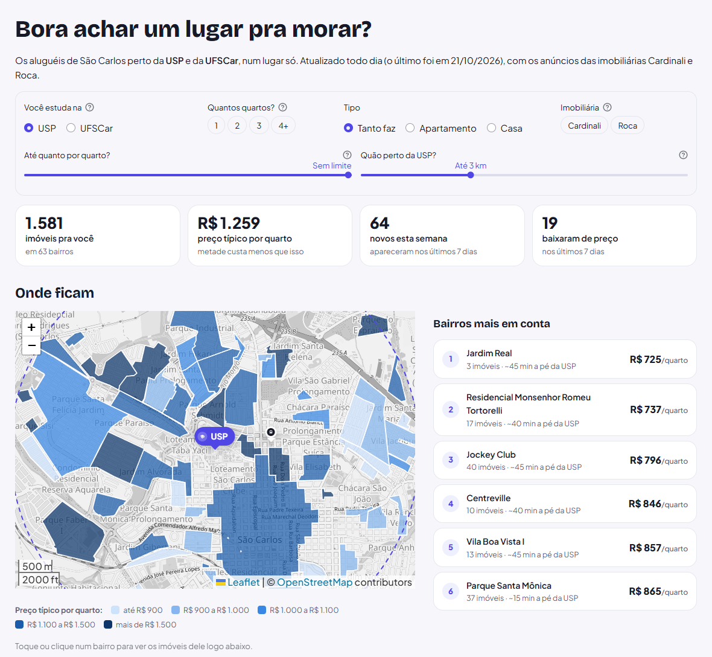
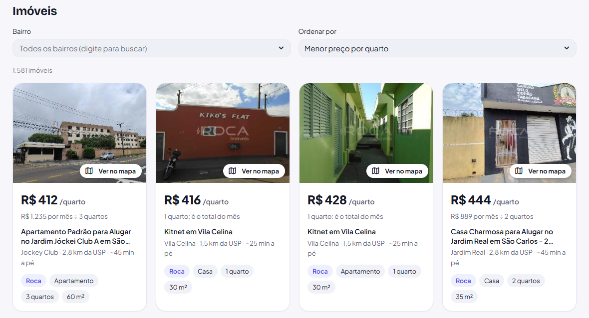
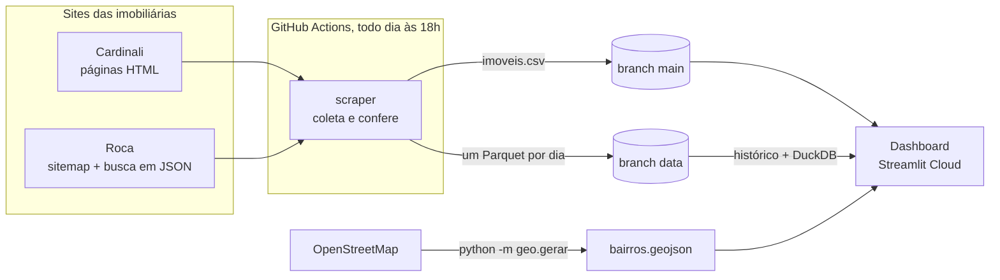

<h1 align="center">🗺️ Imobiliário Universitário</h1>

<p align="center">
  <b>Os aluguéis de São Carlos – SP num mapa interativo, pensado para quem estuda na USP ou na UFSCar.</b><br>
  Um web scraper coleta os anúncios todo dia, e um dashboard mostra onde morar gastando menos.
</p>

<p align="center">
  <a href="https://imobiliariouniversitario.streamlit.app/">
    
  </a>
</p>

<p align="center">
  <a href="https://github.com/imarcososhiro/imobiliario_universitario/actions/workflows/main.yml"></a>
  <a href="https://github.com/imarcososhiro/imobiliario_universitario/tree/data/snapshots"></a>
  <a href="https://github.com/imarcososhiro/imobiliario_universitario/actions/workflows/testes.yml"></a>
  
</p>

<p align="center">
  <a href="https://imobiliariouniversitario.streamlit.app/">
    
  </a>
</p>

> [!TIP]
> O site "dorme" quando fica um tempo sem visitas. Se aparecer o aviso *This app has gone to sleep*, clique no botão azul **Yes, get this app back up!** e espere cerca de um minuto.

<p align="center">
  <a href="#sobre-o-projeto">Sobre</a> ·
  <a href="#funcionalidades">Funcionalidades</a> ·
  <a href="#como-funciona">Como funciona</a> ·
  <a href="#rodando-localmente">Rodando localmente</a> ·
  <a href="#estrutura-do-projeto">Estrutura</a> ·
  <a href="#métricas">Métricas</a> ·
  <a href="#documentação-técnica">Documentação técnica</a>
</p>

---

## Sobre o projeto

Procurar onde morar em São Carlos é abrir dezenas de anúncios em sites diferentes, sem saber se o preço é bom nem se o bairro fica perto do campus. Este projeto junta tudo num lugar só:

- um **web scraper** coleta, todo dia, os aluguéis de casas e apartamentos da cidade toda nas imobiliárias **Cardinali** e **Roca** (hoje, cerca de 2.200 anúncios);
- um **dashboard** mostra esses imóveis num mapa de bairros, com o **preço por quarto**, a distância até a USP, a UFSCar ou a rodoviária, e os imóveis que acabaram de entrar ou baixaram de preço.

O painel abre mostrando os imóveis a até 3 km da USP; os filtros mudam o lugar e a distância (até a cidade toda). O teto é de R$ 8.000 por mês de valor total, pensando desde quem vai morar sozinho numa kitnet até quem procura uma casa para a república.

> [!NOTE]
> Projeto feito para fins educacionais e acadêmicos, sem vínculo com as imobiliárias. Os dados são públicos, a coleta respeita o `robots.txt` dos sites e nenhum dado pessoal é guardado (nem o endereço dos imóveis: o projeto fica no nível do bairro).

## Funcionalidades

- 💸 **Preço por quarto**: o total por mês (aluguel + condomínio + IPTU) dividido pelo número de quartos. Com um quarto para cada pessoa, é quanto cada uma paga, e assim dá para comparar uma kitnet com uma casa de república. O cartão mostra a conta, para quem vai dividir de outro jeito.
- 🗺️ **Mapa dos bairros**: cada bairro pintado pelo preço típico por quarto, com os campi, a rodoviária e um círculo com a distância escolhida. Ao lado, os bairros mais em conta.
- 🔗 **Do mapa à lista e de volta**: clicar num bairro desce a página até os imóveis dele; o botão **Ver no mapa** de cada cartão mostra o bairro do imóvel no mapa.
- 🎯 **Filtros em forma de pergunta**: onde você estuda (e, na UFSCar, se quer morar perto do campus ou da rodoviária, de onde saem os ônibus), quantos quartos, tipo, imobiliária, até quanto por quarto e quão perto.
- 🆕 **Novidades**: selos **Novo** (apareceu nos últimos 7 dias) e **Baixou de preço** (com o valor antigo riscado), calculados a partir do histórico diário.
- 🏢 **Várias imobiliárias**: os anúncios da Cardinali e da Roca juntos, com o selo **"Também na Roca?"** quando a outra imobiliária parece anunciar o mesmo imóvel.
- 🃏 **Cartões e tabela**: foto, preço por quarto, tempo a pé e quartos; ordenação (mais barato, mais perto, novidades primeiro...), busca por bairro e a tabela completa. No celular, os cartões ficam deitados para caber mais na tela.

<p align="center">
  
</p>

## Como funciona



1. **Coleta.** O scraper (`python -m scraper`) usa httpx e BeautifulSoup: na Cardinali, lê as listagens de aluguel e a página de cada imóvel; na Roca, lê o sitemap e pede os dados à busca do próprio site, que responde em JSON. Os dois sites entregam o conteúdo pronto, então não é preciso abrir um navegador.
2. **Conferência.** Antes de gravar, a coleta confere se o resultado faz sentido (taxa de falhas e queda brusca na quantidade de imóveis de cada imobiliária). Se algo parecer quebrado, o CSV anterior é mantido e uma issue avisa do problema.
3. **Histórico.** A coleta de cada dia também vira um arquivo Parquet no branch `data`, formando um histórico desde nov/2025 (os meses anteriores foram reconstruídos a partir das versões antigas do CSV no git). Com DuckDB, dá para consultar todos os dias de uma vez em SQL.
4. **Mapa.** Os contornos dos bairros vêm do OpenStreetMap, ajustados às quadras e com correções manuais (São Carlos não tem bairros oficiais no IBGE).
5. **Dashboard.** O app em Streamlit lê o CSV, baixa o histórico do branch `data`, calcula as métricas com Pandas e desenha o mapa com Folium. A cada filtro, tudo é recalculado.

## Rodando localmente

Precisa de Python 3.13 (a versão usada no GitHub Actions).

**Dashboard**

```bash
git clone https://github.com/imarcososhiro/imobiliario_universitario
cd imobiliario_universitario
pip install -r requirements.txt
streamlit run Home.py
```

**Atualizar os dados na hora** (leva poucos minutos)

```bash
pip install -r requirements-scraper.txt
python -m scraper
```

**Rodar os testes** (usam páginas salvas, sem acessar os sites)

```bash
pip install -r requirements-dev.txt
python -m pytest
```

**Explorar o histórico diário** (fica no branch `data`)

```bash
git fetch origin data
git worktree add historico-data data
python -m historico.consultas historico-data/snapshots
```

## Estrutura do projeto

```text
imobiliario_universitario
├── Home.py                  a página do dashboard (entrada do Streamlit Cloud)
├── app/                     peças do dashboard
│   ├── dados.py             lê o CSV (só residenciais, total até R$ 8.000) e aplica os filtros
│   ├── metricas.py          preço por quarto, área, distâncias e resumo por bairro
│   ├── mapa.py              o mapa: bairros pintados, campi, rodoviária e bairro em destaque
│   ├── interface.py         filtros, números, cartões, tabela, rolagem da página e CSS
│   ├── historico.py         baixa o histórico e marca os selos Novo e Baixou de preço
│   ├── bairros.py           contornos e nomes padrão dos bairros
│   └── formatacao.py        números no formato brasileiro (R$ 1.234, 2,3 km)
├── scraper/                 a coleta (python -m scraper)
│   ├── coleta.py            orquestra, confere o resultado e grava o CSV
│   ├── cardinali.py         adaptador da Cardinali (listagens e página de cada imóvel)
│   ├── roca.py              adaptador da Roca (sitemap e busca em JSON, em lotes)
│   ├── modelo.py            formato comum de um imóvel, igual para qualquer imobiliária
│   ├── conversao.py         textos do site ("1.667,50", "Consulte-nos") em números
│   ├── download.py          downloads que tentam de novo quando o site falha
│   └── alertas.py           abre e fecha a issue quando a coleta quebra
├── historico/
│   ├── snapshot.py          converte a coleta do dia num Parquet de esquema fixo
│   ├── backfill.py          reconstrói o histórico a partir das versões do CSV no git
│   └── consultas.py         consultas em SQL (DuckDB), usadas também pelo dashboard
├── geo/                     gera dados/geo/bairros.geojson a partir do OpenStreetMap
├── dados/
│   ├── imoveis.csv          a coleta mais recente (atualizada pelo GitHub Actions)
│   └── geo/                 contornos dos bairros e as correções manuais
├── tests/                   testes automatizados; fixtures/ guarda páginas reais dos sites
├── assets/                  imagem mostrada quando nenhum imóvel passa pelos filtros
├── docs/                    prints do dashboard usados neste README
├── .streamlit/config.toml   tema do app (cores e fontes)
├── .github/workflows/       main.yml (coleta diária) e testes.yml (testes a cada mudança)
└── requirements*.txt        dependências do dashboard, do scraper e de desenvolvimento
```

As dependências ficam em três arquivos para cada ambiente instalar só o que precisa: `requirements.txt` (Streamlit Cloud), `requirements-scraper.txt` (GitHub Actions) e `requirements-dev.txt` (tudo, mais os testes).

## Métricas

Poucas e simples, para ninguém precisar pensar demais:

| Métrica | Como é calculada | Por que importa |
|---|---|---|
| Preço por quarto | total por mês (aluguel + condomínio + IPTU) ÷ nº de quartos (kitnet sem quartos no anúncio conta como 1) | Com um quarto para cada pessoa, é quanto cada uma paga: compara de forma justa uma kitnet e uma casa de república |
| Preço típico | a mediana: metade dos imóveis custa menos, metade custa mais | Diferente da média, não se deixa levar por um anúncio caríssimo |
| Distância | em linha reta, do bairro até o lugar escolhido (USP, UFSCar ou rodoviária) | Os sites não informam o endereço, então todos os imóveis de um bairro têm a mesma distância |
| Tempo a pé | distância + 30% (as ruas fazem curvas), a 4,8 km/h, arredondado de 5 em 5 minutos | "~20 min a pé" é mais fácil de imaginar que "1,2 km" |

Quem estuda na UFSCar escolhe medir a distância até a **rodoviária** (muita gente mora no centro e vai de ônibus, que sai de lá) ou até o campus; a rodoviária vem marcada, por ser o mais comum.

No mapa, os bairros são divididos em **5 faixas com quantidades parecidas de bairros**, e não em faixas de preço de tamanho igual: assim um bairro caríssimo não deixa todos os outros com a mesma cor. A lista de bairros mais em conta só inclui bairros com pelo menos 3 imóveis. Imóveis só comerciais e reservados ficam de fora.

## Documentação técnica

Os detalhes de cada parte, para quem quer entender, manter ou estender o projeto.

### Várias imobiliárias

Cada imobiliária é um módulo em `scraper/` que converte os anúncios para o mesmo formato (`scraper/modelo.py`), com a coluna `fonte` dizendo de onde veio cada um. Assim o dashboard, o histórico e as métricas tratam todas do mesmo jeito.

| Imobiliária | Como é coletada | Pedidos por dia |
|---|---|---|
| [Cardinali](https://www.cardinali.com.br) | Listagens de aluguel e a página de cada imóvel (HTML renderizado no servidor, com dados estruturados JSON-LD) | ~1.000 |
| [Roca](https://roca.com.br) | O sitemap (indicado no `robots.txt`) lista os imóveis; a busca do próprio site (`/api/solr/search/`) devolve os dados em JSON, em lotes de 200 | ~8 |

Os dois `robots.txt` permitem a coleta. Da Roca entram as casas e apartamentos para alugar em São Carlos; ficam de fora os que o site marca como "não aluga para estudantes" e as casas de uso comercial. O endereço completo que a busca da Roca devolve **não é guardado**.

**Aluguel "sob consulta" na Roca:** o site esconde o aluguel ("Valor sob consulta") dos imóveis que ainda estão alugados, com previsão de saída do inquilino ("Disponível em breve"), e dos que a imobiliária escondeu à mão. A busca não traz a marcação que a página usa para isso, então o scraper reconhece esses imóveis pelos sinais que ela traz: a data de previsão de saída (`dtaPrevisionOutput`) e a lista de portais de anúncio vazia (`portalLocation`). Eles ficam sem aluguel e sem total, como o "Consulte-nos" da Cardinali, e por isso fora do dashboard. Se a busca deixar de trazer os portais de todos os imóveis, a coleta falha, em vez de esconder o preço de todos.

- **Tudo ou nada**: se uma imobiliária falhar, o CSV do dia não é gravado (e o [aviso por issue](#operação) dispara). Gravar só as outras faria os imóveis dela "saírem" do site por um dia no histórico.
- **Validação por imobiliária**: a queda de mais de 30% é medida em cada uma, para uma queda forte numa não ficar escondida no total.
- **Estreia**: no primeiro dia de uma imobiliária no histórico, os imóveis dela não ganham o selo **Novo** (eles aparecem "pela primeira vez" sem serem novos).
- **Possível duplicata**: quando outra imobiliária tem um anúncio no mesmo bairro, com o mesmo nº de quartos, área até 3% e total até 5% diferentes, o cartão ganha o selo **"Também na Roca?"** (ou na Cardinali). O painel só avisa e nunca junta os anúncios: pode ser coincidência, e o preço pode ser diferente em cada uma.

**Para incluir outra imobiliária**: crie `scraper/<nome>.py` com `FONTE` e um jeito de coletar (`listar_urls` + `extrair_imovel`, página por página, como a Cardinali; ou `baixar_imoveis`, em lote, como a Roca), acrescente o módulo em `FONTES` (`scraper/coleta.py`) e o nome em `IMOBILIARIAS` (`app/dados.py`), e escreva os testes com fixtures salvas do site.

### Histórico no dashboard

O histórico fica no branch `data` (um Parquet por dia, em `snapshots/AAAA/AAAA-MM-DD.parquet`), mas o Streamlit Cloud só tem o branch `main`. Por isso o dashboard **baixa o branch `data` inteiro como um `.tar.gz`** direto do GitHub (`codeload.github.com/.../tar.gz/refs/heads/data`, poucos MB, um pedido só), extrai os Parquet numa pasta temporária e consulta tudo com DuckDB, reaproveitando `historico/consultas.py`. O resultado fica em cache por 3 horas (`st.cache_data`), então o download acontece poucas vezes por dia, e não a cada visita.

Se o download falhar (GitHub fora do ar, sem internet), **o dashboard continua funcionando**: só não mostra os selos nem os números de novidades, e avisa que o histórico não pôde ser carregado.

| O que aparece | Regra |
|---|---|
| Selo **Novo** | O imóvel foi visto pela primeira vez nos últimos 7 dias |
| Selo **Baixou de preço** | A última mudança do total por mês foi uma queda, nos últimos 7 dias, e o preço de hoje ainda é o da queda. O valor de antes aparece riscado |
| **Novos esta semana** e **Baixaram de preço** | Quantos imóveis com cada selo passam pelos filtros escolhidos |

> [!WARNING]
> Até 14/10/2026 a coleta cobria só ~30 bairros da região universitária; a partir de 15/10/2026 cobre a cidade toda. Nesse dia, ~480 imóveis aparecem "pela primeira vez" sem serem novos de verdade, então ninguém que apareceu nesse dia (nem no primeiro dia do histórico) ganha o selo Novo. Leve isso em conta ao comparar períodos.

Para testar sem internet, a variável de ambiente `HISTORICO_URL` troca o endereço do histórico (os testes apontam para um `.tar.gz` sintético, `file:///...`).

### Mapa dos bairros

São Carlos não tem bairros oficializados em lei (por isso não aparece na malha de bairros do IBGE). Os contornos vêm do [OpenStreetMap](https://www.openstreetmap.org/), onde a maioria dos bairros (loteamentos) da cidade está desenhada. O arquivo `dados/geo/bairros.geojson` é gerado por `python -m geo.gerar` e diz de onde veio cada contorno (`origem`):

| `origem` | O que é |
|---|---|
| `osm` | Contorno desenhado no OpenStreetMap |
| `enderecos` | O bairro só tem um ponto no OSM; o contorno envolve os endereços do OSM marcados com esse bairro (é o caso do Centro) |
| `aproximado` | Sem endereços suficientes: a área em volta do ponto do bairro (até 700 m) que nenhum bairro vizinho ocupa |
| `manual` | Desenhado à mão em `dados/geo/desenhos_manuais.geojson` |

Os contornos calculados (`enderecos` e `aproximado`) são **ajustados às quadras**: o gerador monta os quarteirões a partir das ruas do OSM e troca cada contorno pela união das quadras que ele cobre em mais da metade, para que as bordas sigam as ruas. Alguns condomínios estão no OSM só como área residencial (`landuse=residential`); eles entram no mapa quando têm imóveis e nenhum outro contorno. O gerador também guarda em cada bairro a distância da borda até o campus mais perto (`distancia_campus_km`).

No dashboard, o fundo é o OpenStreetMap em tons de cinza (um filtro CSS nos tiles), para as cores dos bairros se destacarem.

**Como corrigir um bairro** (depois, rode `python -m geo.gerar` de novo):

- *O site escreve o nome diferente do mapa* (ex.: "Jardim Hikari" e "Jardim Hikare"): adicione uma linha em `dados/geo/aliases_bairros.csv`.
- *O ponto do bairro está no lugar errado*: ajuste em `dados/geo/pontos_manuais.csv` (latitude e longitude, que dá para copiar do Google Maps). Esses pontos valem mais que os do OSM.
- *O contorno está ruim ou não existe*: desenhe o bairro no [geojson.io](https://geojson.io), dê a ele a propriedade `"bairro": "Nome do Bairro"` e cole a feature em `dados/geo/desenhos_manuais.geojson`.

No fim, o gerador lista os bairros com imóveis que ficaram sem contorno: os imóveis deles continuam na tabela, só não aparecem no mapa.

### Do mapa à lista e da lista ao mapa

Duas interações que o Streamlit não faz sozinho:

- **Clicar num bairro do mapa** escolhe o bairro na lista e desce a página até ela. O mapa (`st_folium`) devolve ao Python o último objeto clicado e o ponto do clique. O ponto muda a cada clique, então é ele que diz se houve um clique novo (mesmo num bairro já clicado). Os pinos dos campi e da rodoviária ficam num grupo, para um clique neles não contar como um clique no último bairro.
- **Ver no mapa**: o cartão inteiro é um link (HTML) para o anúncio, e um clique no HTML não chega ao Python. Por isso o botão é um `st.button` de verdade, no mesmo container do cartão (`st.container(key="cartao-N")`): o CSS acha o container pela classe `st-key-cartao-N` e põe o botão por cima da foto. O clique guarda o bairro, e o mapa é desenhado de novo, centralizado nele, com o contorno e o nome em destaque.

**Rolar a página** precisa de JavaScript, e o Streamlit não roda scripts de `st.markdown` nem de `st.html`. O `components.html` roda, num iframe invisível que é da mesma origem da página e por isso alcança a página por `window.parent`. O script vai no fim da página (com tudo já desenhado) e muda a cada pedido (tem um contador): com o HTML igual, o Streamlit reaproveitaria o iframe e o script não rodaria de novo.

> [!CAUTION]
> O `st.html` passa o HTML pelo DOMPurify, que descarta um `<style>` inteiro, sem erro nenhum, se o texto dele tiver algo parecido com uma tag (até dentro de um comentário). Um teste garante que o CSS de `app/interface.py` não tem `<`.

### Operação

A coleta roda sozinha todo dia às 18h (horário de Brasília) no GitHub Actions (`.github/workflows/main.yml`). Para saber se ela está saudável sem precisar abrir o Actions:

- **Resumo da execução**: a página de cada execução mostra uma tabela com os imóveis anunciados e coletados, o que mudou desde a última coleta (novos, saíram, mudaram de preço), as falhas, as novas tentativas de download e a duração. Muitas novas tentativas, mesmo sem falhas, indicam que o site ou a conexão andam instáveis.
- **Se algo quebrar**:
  - o CSV anterior é mantido, então o dashboard continua mostrando a última coleta que deu certo;
  - uma **issue com o rótulo `coleta-quebrada`** é aberta (ou ganha um comentário, se já houver uma aberta), com o link da execução, a etapa que falhou e o fim do log. O GitHub avisa por e-mail quem acompanha o repositório;
  - o HTML das páginas que o scraper não conseguiu ler fica 14 dias no artefato **`paginas-com-falha`** da execução, junto de um `falhas.csv` (URL, motivo e arquivo de cada falha).
- **Quando voltar a funcionar**, a issue ganha um comentário e é fechada sozinha.

**Como investigar uma falha:**

1. Baixe o artefato `paginas-com-falha`, abra o HTML e veja o que mudou no site.
2. Salve a página como fixture: `python -m tests.salvar_fixture <url> <nome>`.
3. Escreva um teste que falha e ajuste o adaptador da imobiliária (`scraper/cardinali.py` ou `scraper/roca.py`).

Para rodar a coleta na hora: aba **Actions** → *Atualizacao de banco de dados imobiliarios* → **Run workflow**. Localmente, `python -m scraper --falhas falhas` guarda o HTML das falhas na pasta `falhas/`.

### Dicionário de dados

<details>
<summary>Colunas de <code>dados/imoveis.csv</code></summary>

| Coluna | Descrição |
|---|---|
| `codigo` | Código do imóvel no site (identifica o mesmo imóvel ao longo dos dias) |
| `fonte` | Imobiliária de origem (`cardinali` ou `roca`). O código só identifica o imóvel junto com a fonte |
| `url` | Link do anúncio |
| `tipo` / `subtipo` | Ex.: Apartamento / Kitchnet; Casa / Sobrado |
| `bairro` | Bairro como escrito no site |
| `titulo` | Título do anúncio |
| `finalidade` | Residencial, Comercial ou ambos |
| `situacao` | Ex.: DISPONÍVEL |
| `aluguel` | Aluguel atual, sem desconto |
| `aluguel_anterior` | Preço "DE:" quando o imóvel está em promoção |
| `aluguel_bonificado` | Aluguel com desconto por pagar em dia |
| `condominio` / `iptu` | Valores mensais |
| `total_mensal` | Total por mês informado pelo site (vazio quando o aluguel é "Consulte-nos" ou "sob consulta") |
| `dormitorios` / `suites` / `banheiros` / `vagas` | Características |
| `area_util_m2` / `area_construida_m2` / `area_total_m2` | Áreas em m² |
| `foto_url` | Primeira foto do anúncio |
| `coletado_em` | Data da coleta |

</details>

## Tecnologias

| Parte | Tecnologias |
|---|---|
| Coleta |    |
| Dados e histórico |    |
| Mapa |    |
| Dashboard |  |
| Automação e testes |    |

## Desenvolvedor

<a href="https://www.linkedin.com/in/imarcososhiro/">
  
</a>

**Marcos Oshiro**

[](https://www.linkedin.com/in/imarcososhiro/)
[](https://github.com/imarcososhiro)
